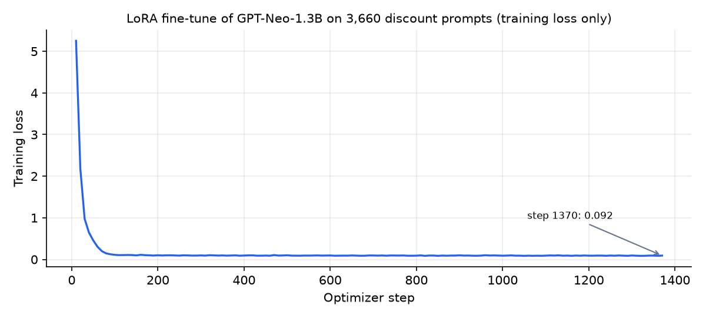
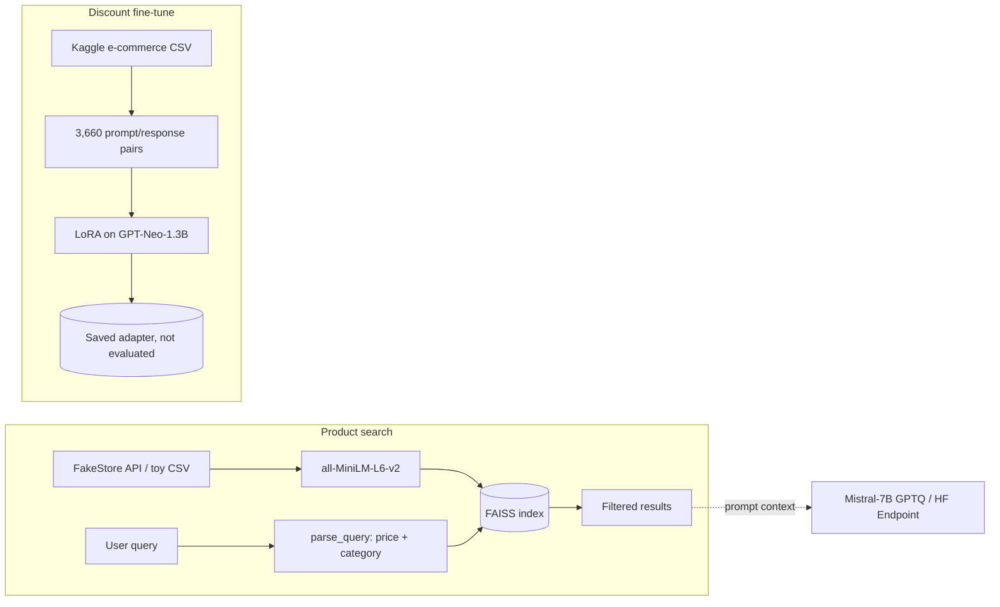

# EcomPriceGen — e-commerce LLM experiments (notebooks)

**Two exploratory Colab notebooks from April 2025: product search with sentence embeddings + FAISS, LangChain agent prototypes, and a LoRA fine-tuning run on discount-price prompts.**

[](https://github.com/Akshatb848/EcomPriceGen-AI-Powered-Pricing-Discount-Calculator/actions/workflows/ci.yml)
[](LICENSE)


> **Scope, honestly.** This is learning and experimentation work, not a finished pricing product. It contains no deployable app and no evaluation. The fine-tuned model was trained but never scored, and the saved inference demo used base GPT-2, not the fine-tuned adapter. An earlier version of this README described a Zephyr-7B model and production-style results. The code does not support that description, and it has been corrected here.

## Glimpse (real saved outputs)

Everything below comes from outputs saved in the notebooks when they ran on Google Colab. Nothing was re-run for this README.

**LoRA training loss** saved by the Hugging Face `Trainer` in `RAG_Agent.ipynb`. The plot is re-drawn from the saved table by [`scripts/plot_training_loss.py`](scripts/plot_training_loss.py):



The run covered 1,371 optimizer steps (3 epochs) in 10 min 34 s on 3,660 prompt/response pairs. Training loss fell from 5.25 at step 10 to 0.092 at step 1,370. **This is training loss only.** There was no held-out set and no accuracy check, and the tokenisation sets `labels` to the response tokens while the inputs are the prompt tokens. A low loss here does not show that the model computes discounts correctly.

**Semantic product search** (`Smart_E_Commerce_Platform.ipynb`, FakeStore API catalogue, `all-MiniLM-L6-v2` + FAISS):

```text
parse_query("find sneakers under $120")
→ {'max_price': 120, 'category': 'sneakers', 'query': 'find sneakers under $120'}

search_products("Nike sneakers under $120")   # top-5 nearest neighbours
→ Mens Casual Premium Slim Fit T-Shirts ($22.30), Fjallraven Foldsack No. 1 Backpack ($109.95),
  DANVOUY Womens T Shirt ($12.99), Acer SB220Q 21.5" monitor ($599.00), Opna Women's Short Sleeve ($7.95)

smart_search("Find sneakers under $120")      # with price + category filters
→ Empty DataFrame
```

The catalogue has no shoes, so the unfiltered search returns loosely related items and the filtered search correctly returns nothing.

**Discount explanation with base GPT-2** (`RAG_Agent.ipynb`). The prompt was "36.53 Rs, 15 % off, final price 31.05 Rs — explain". The saved output is **wrong and incoherent** ("...the final discount of 30 Rs is 25.00 Rs... 30 lakh Rs for three year period"). It shows why an untuned small model is not suitable for arithmetic.

## What's in the notebooks

### `RAG_Agent.ipynb`
1. A three-product toy catalogue, embedded with `all-MiniLM-L6-v2` and retrieved with FAISS (`"cheap smartphones"` → Smartphone X200 ₹14,999, then headphones).
2. Loads `TheBloke/Mistral-7B-Instruct-v0.2-GPTQ` with `auto-gptq` and generates a plain answer, then builds a retrieval-augmented prompt from FAISS results. The RAG generation cells have no saved output. A first load attempt via `optimum.gptq` failed with an `ImportError`, which is kept in the notebook.
3. Builds `ecommerce_finetune_dataset.jsonl` from the Kaggle dataset `steve1215rogg/e-commerce-dataset`, using rows like *"category X, priced at P Rs, discount D % — what is the final price?"* → *"The final price after the discount is F Rs."*
4. LoRA fine-tuning (`peft`, r=8, α=16, `q_proj`/`v_proj`) of **EleutherAI/gpt-neo-1.3B** on those 3,660 pairs, then saves the adapter (see the loss plot above).
5. A GPT-2 generation demo (base model, not the adapter).

### `Smart_E_Commerce_Platform.ipynb`
1. Fetches products from the public [FakeStore API](https://fakestoreapi.com/), embeds them, and builds a FAISS index.
2. `parse_query` (regex for "under $N" + category keywords), `smart_search` (vector search + filters) and `suggest_bundle`.
3. LangChain agents over a `HuggingFaceEndpoint` (Mistral-7B-Instruct, later GPT-2). Several attempts end in `ValueError`/`ValidationError`, which are kept. The working version wraps **hard-coded** tool responses (e.g. a fixed list of sneakers and socks).
4. A console shopping flow: product list from FakeStore, `input()`-driven cart, a fake profile, and a random "confirmation number". No real payment is processed.

## Architecture (as explored)



## Tech stack

Python · Google Colab (GPU) · pandas · sentence-transformers · FAISS · Hugging Face Transformers, PEFT (LoRA), Datasets, auto-gptq · LangChain + `langchain-huggingface` · Kaggle Hub

## Running the notebooks

They were written for **Google Colab with a GPU**. Open one in Colab, or locally:

```bash
pip install -r requirements.txt      # heavy: PyTorch, Transformers, FAISS, LangChain
cp .env.example .env                 # then set your own tokens
export $(grep -v '^#' .env | xargs)
jupyter lab
```

## Environment variables

| Variable | Used by | Purpose |
|---|---|---|
| `HF_TOKEN` | `RAG_Agent.ipynb` | `huggingface_hub.login(token=os.environ["HF_TOKEN"])` |
| `HUGGINGFACEHUB_API_TOKEN` | `Smart_E_Commerce_Platform.ipynb` | LangChain `HuggingFaceEndpoint` |

The fine-tuning section also asks you to upload your own `kaggle.json` (git-ignored). Never commit tokens. On Colab, use the *Secrets* panel.

## Testing / CI

The notebooks need a GPU and network access to model hubs, so CI does **not** execute them. Instead, [`.github/workflows/ci.yml`](.github/workflows/ci.yml) runs:
- `ruff check --select E9,F63,F7,F82` over the notebooks and scripts (syntax errors, undefined names)
- [`tests/test_notebooks.py`](tests/test_notebooks.py): notebooks parse as nbformat-4 JSON, contain no credential-shaped strings in code or saved outputs, and read Hugging Face tokens from `os.environ`

```bash
pip install -r requirements-dev.txt && pytest
```

## Project structure

```
RAG_Agent.ipynb                   retrieval demo, GPTQ Mistral, dataset build, LoRA fine-tune, GPT-2 demo
Smart_E_Commerce_Platform.ipynb   FakeStore search, LangChain agent attempts, console cart flow
scripts/plot_training_loss.py     re-plots the saved training-loss table
docs/training-loss.png            output of the script above
tests/test_notebooks.py           static notebook + secret checks
requirements.txt / -dev.txt       notebook deps / CI + script deps
.env.example                      token variable names (no values)
```

## Limitations

- Exploratory notebooks with errors and retries left in. Cells depend on Colab state and execution order.
- No evaluation of the fine-tuned model. Its pricing accuracy is unknown.
- The agent demos use hard-coded tool outputs. The "payment" step is simulated.
- Discount arithmetic is deterministic (`price * (1 - d/100)`). A language model is not the right tool for computing it, only possibly for explaining it.
- Hugging Face tokens were committed in earlier revisions of the notebooks and removed in October 2026 (PR #1). Those tokens must be treated as compromised and revoked. Git history was not rewritten.

## License

[MIT](LICENSE) © 2026 Akshat Banga

## Author

**Akshat Banga** — [github.com/Akshatb848](https://github.com/Akshatb848)
